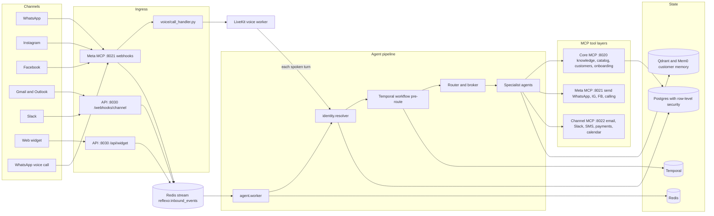
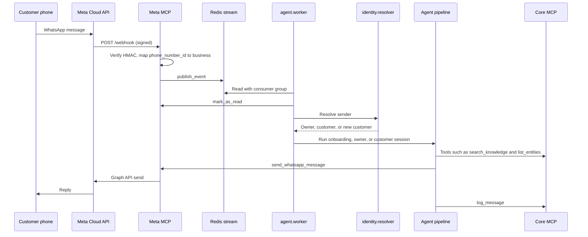
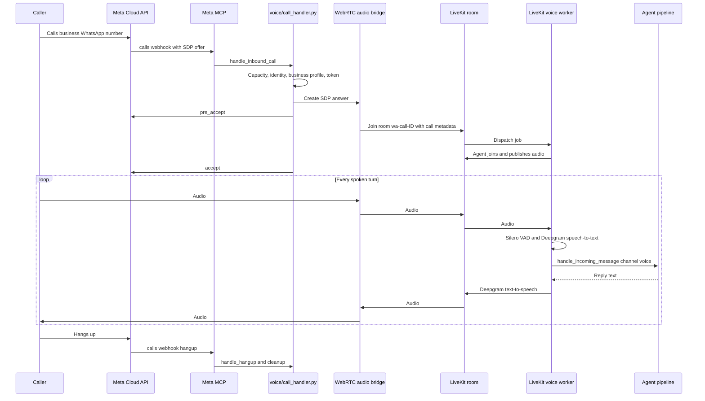

# Reflexo

Reflexo gives every business an AI employee that answers customers and the owner on WhatsApp, Instagram, Facebook, email, Slack, a website chat widget, and live WhatsApp voice calls. Every channel feeds the same brain, the same customer identity, and the same memory, so a customer who messages on WhatsApp and later calls is recognized as the same person.

## Omnichannel architecture

Every inbound message, whatever the channel, is normalized into one event shape and placed on a durable Redis stream. A single agent pipeline consumes that stream, works out who is talking, decides what to do, and replies through the channel the message came from. Voice calls use the same pipeline turn by turn.



Key design points:

- **One event shape, one queue.** Meta webhooks, email, Slack, and widget messages are all published to `reflexo:inbound_events` (`mcp_servers/meta_mcp/webhooks/resolve.py`, `shared/redis_keys.py`). Consumers use a Redis consumer group, so a crashed worker does not lose messages.
- **One identity per person.** `identity/resolver.py` maps a phone number, Instagram ID, Facebook ID, or email to a single customer (or the business owner), using `identity_map` and a Redis cache.
- **Tools live behind MCP.** The agent never calls Meta, Gmail, or the database directly. It calls tools on three MCP servers, loaded through `langchain-mcp-adapters` (`agent/tools.py`). Owners can also connect their own external MCP servers.
- **Tenant isolation.** Business data is protected by Postgres row-level security. Code uses `shared/db.py` `tenant_connection(business_id)` for tenant reads and writes.
- **Shared memory.** Conversation state is checkpointed by LangGraph in Postgres, and long-term customer facts are extracted into Qdrant through Mem0 by Celery.

## Services

| Process | Command | Port | Responsibility |
|---|---|---|---|
| Core MCP | `python -m mcp_servers.reflexo_core.server` | 8020 | Knowledge base, catalog, business config, customers, conversations, workflows, gaps, documents, onboarding tools |
| Meta MCP | `python -m mcp_servers.meta_mcp.server` | `META_MCP_PORT` (8021) | WhatsApp, Instagram, and Facebook webhooks and send tools; WhatsApp calling events |
| Channel MCP | `python -m channel_framework.mcp_server` | 8022 | Gmail, Outlook, Slack, Fast2SMS, Razorpay, and Google Calendar tools |
| API | `python -m api.server` | 8030 | Signup, Meta OAuth, admin REST API, widget, Connection Hub, channel webhooks, workflow studio |
| Agent worker | `python -m agent.worker` | none | Consumes the inbound stream and runs the agent pipeline |
| Workflow worker | `python -m workflow_builder.worker` | none | Runs Temporal AI workflows |
| Celery worker and beat | `celery -A onboarding.celery_app worker` and `beat` | none | Onboarding reminders, memory extraction, template sync, channel subscription renewal, workflow pattern analysis |
| Voice worker | `python -m voice dev` | none | LiveKit agent that talks on WhatsApp calls |
| Admin panel | `npm run dev` in `admin-panel/` | 3000 | Next.js staff console and simulator |
| Infrastructure | `docker compose up -d` | 7233, 8088, 6333 | Temporal, Temporal UI, Qdrant |

Postgres and Redis are external (for example Neon and Upstash, or local instances).

## How a WhatsApp message is handled



1. **Webhook.** Meta posts to `/webhook` on the Meta MCP server. The request signature is checked with `META_APP_SECRET` (`mcp_servers/meta_mcp/auth/signature.py`).
2. **Business lookup.** The WhatsApp `phone_number_id` is mapped to a business through the active row in `business_channels` (`resolve_business_from_channel`).
3. **Queue.** The parsed message is written to the Redis stream and also published on `incoming:{business_id}` for live dashboards.
4. **Identity.** `agent.worker` reads the event and `identity/resolver.py` decides whether the sender is the owner, a known customer, or a new customer.
5. **Session type.** An owner whose business has not finished setup gets the conversational **onboarding** agent. Otherwise owners get the owner agent and customers get the customer agent (`agent/session.py`).
6. **Workflow pre-route.** Before the language model runs, `agent/pipeline.py` checks whether the message triggers a saved AI workflow. If it does, Temporal runs it, and owner YES/NO confirmations are handled in `workflow_builder/confirmation.py`.
7. **Routing.** The router and broker (`agent/router.py`, `agent/broker.py`) pick a specialist (for example inquiry, support, or booking). The specialist calls tools on the MCP servers.
8. **Reply and log.** The reply goes out through `send_whatsapp_message` on Meta MCP, and both sides of the exchange are logged through `log_message` on Core MCP.

Instagram and Facebook messages follow the same path through their own webhook parsers in `mcp_servers/meta_mcp/webhooks/`.

## How a WhatsApp voice call is handled



1. **Incoming call.** Meta sends a `calls` webhook with a WebRTC SDP offer. `voice/call_handler.py` maps the number to a business and starts setup.
2. **Setup.** The handler reserves a call slot (`voice/limits.py`), resolves the caller's identity, loads the business profile, opens a voice conversation record, and loads the WhatsApp token.
3. **Audio bridge.** `voice/bridge.py` answers Meta's SDP offer and joins a LiveKit room named `wa-call-{call_id}`. The call context (business, caller, owner or customer) is stored in the room metadata.
4. **Agent joins.** LiveKit dispatches the job to the voice worker (`voice/worker.py`). The handler waits until the agent's audio track is live, then sends `accept` to Meta through `voice/meta_api.py`, so the caller does not hear silence.
5. **Each turn.** The worker (`voice/session.py`) uses Silero for voice activity detection and Deepgram for speech-to-text. Each final transcript is sent through the same `handle_incoming_message` pipeline as text messages, with `channel="voice"`. The reply is spoken with Deepgram text-to-speech. Voice and text therefore share knowledge, routing, workflows, and memory.
6. **During the call.** The agent can ask the caller to share a file or photo on WhatsApp. `voice/cross_channel.py` pushes that content into the live call so the agent can talk about it immediately.
7. **Outbound calls.** The business can also call customers who have granted call permission (`voice/outbound.py`).
8. **Hangup.** The hangup webhook triggers `handle_hangup`, which closes the bridge, releases the call slot, and records the call end.

## Other channels

- **Email and Slack.** Owners connect Gmail, Outlook, or Slack from the Connection Hub (`/connect/{business_id}` in the admin panel, backed by `channel_framework/connection_hub.py`). Credentials are encrypted in `connected_accounts`. Provider webhooks arrive at `/webhooks/channel/*` (`channel_framework/webhook_receiver.py`), run through the same agent session, and are delivered by `channel_framework/outbound.py`. Each account has confidence thresholds that decide whether a reply is sent automatically or held as a draft.
- **Website widget.** `widget/widget.js` is a script tag a business adds to its site. It posts to `/api/widget/{business_id}/send` and receives replies over server-sent events. Widget messages enter the same Redis stream as WhatsApp.
- **Payments, SMS, and calendar.** Razorpay, Fast2SMS, and Google Calendar are tools on the Channel MCP server that any specialist can call.

## Onboarding, workflows, and admin

- **Conversational onboarding.** A new owner signs up (`POST /api/signup`) and finishes setup by chatting on WhatsApp. The onboarding agent saves the business name, hours, catalog, and channels step by step through Core MCP onboarding tools. Celery sends reminders if the owner goes quiet.
- **AI workflows.** Owners describe automations in plain language in the workflow studio (`/wf/{token}`). Workflows are stored in `ai_workflows` and executed by Temporal (`workflow_builder/`), with owner confirmation steps where needed.
- **Admin panel.** `admin-panel/` is a Next.js console for staff: businesses, conversations, knowledge, catalog, workflows, agent persona, integrations, MCP connections, routing analytics, billing, and a simulator that runs the real pipeline with a visual trace.

## Local setup

1. Copy the environment template and fill in Postgres, Redis, Gemini, Meta, LiveKit, and Deepgram values:

   ```bash
   cp .env.example .env
   ```

2. Install Python dependencies (Python 3.12 or newer):

   ```bash
   python -m venv .venv
   .venv/Scripts/activate      # Windows
   # source .venv/bin/activate  # macOS / Linux
   pip install -r requirements.txt
   ```

3. Create the schema:

   ```bash
   python scripts/apply_migrations.py
   python scripts/verify_schema.py
   ```

4. Start Temporal and Qdrant:

   ```bash
   docker compose up -d
   ```

5. Start each process in its own terminal:

   ```bash
   python -m mcp_servers.reflexo_core.server
   python -m mcp_servers.meta_mcp.server
   python -m channel_framework.mcp_server
   python -m api.server
   python -m agent.worker
   python -m workflow_builder.worker
   celery -A onboarding.celery_app worker -l info --pool=solo   # --pool=solo on Windows
   celery -A onboarding.celery_app beat -l info
   python -m voice dev
   ```

6. Start the admin panel:

   ```bash
   cd admin-panel
   npm install
   npm run dev
   ```

7. Connect WhatsApp: expose the Meta MCP port over HTTPS (for example with ngrok), set the Meta app webhook to `https://<host>/webhook` with `META_VERIFY_TOKEN`, subscribe to `messages` and `calls`, then seed the channel:

   ```bash
   python scripts/seed_whatsapp_channel.py
   python scripts/check_live_whatsapp_ready.py
   ```

   Use a permanent Meta **System User** token in `META_SYSTEM_ACCESS_TOKEN`. User tokens expire and are revoked when the same admin logs in again.

## Testing

```bash
pytest -q                                   # full suite
python scripts/ci_mvp_gate.py               # CI gate subset
python scripts/smoke_whatsapp_live.py       # WhatsApp credential check (add --send to send a message)
python -m scripts.diagnose_meta_tokens      # Stored Meta token type, validity, and scopes
python scripts/check_voice_ready.py         # LiveKit, Deepgram, Redis, and database readiness
python scripts/start_onboarding.py --phone +91XXXXXXXXXX --seed-whatsapp
```

Live model evaluations are opt-in: set `RUN_EVAL=1` and `GOOGLE_API_KEY`.

## Windows notes

- LangGraph's async Postgres driver (psycopg) cannot run on Windows' default `ProactorEventLoop`. The agent worker and API use a `SelectorEventLoop` through `agent/asyncio_compat.py`, and the voice worker switches each LiveKit call process to a Selector loop in `prewarm()` in `voice/worker.py`.
- Celery needs `--pool=solo` on Windows.
- If `META_MCP_PORT` is changed (for example to 80 for a tunnel), keep `META_MCP_MCP_URL` pointing at the same port.
